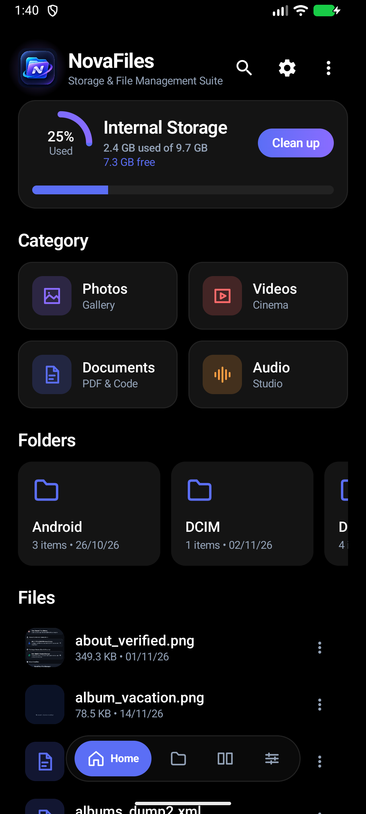
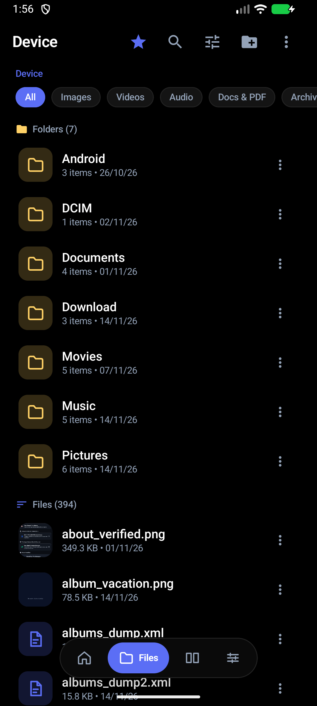
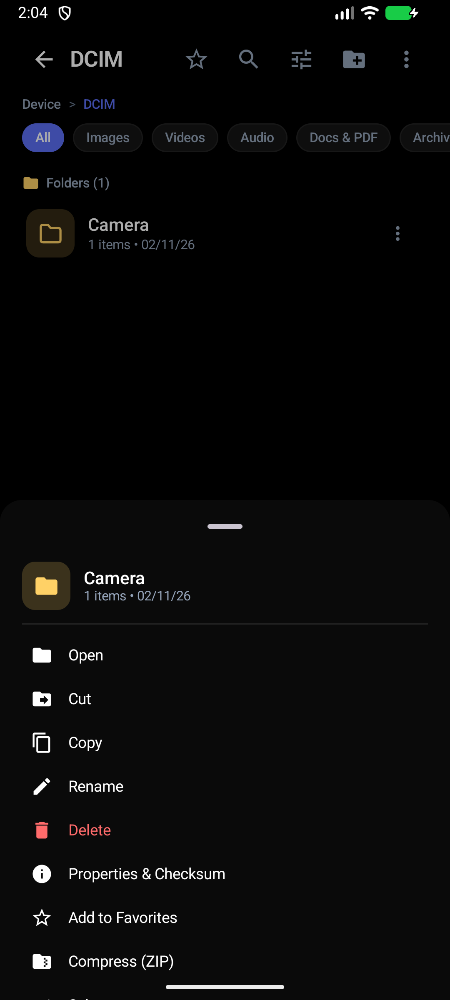
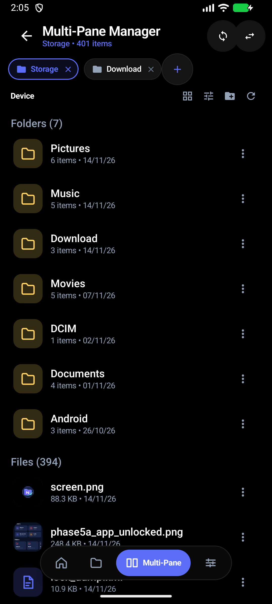
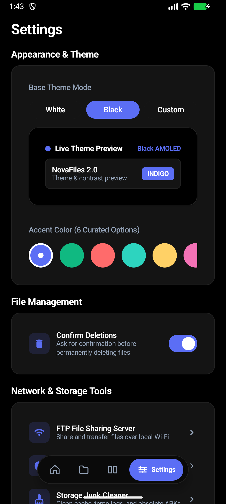
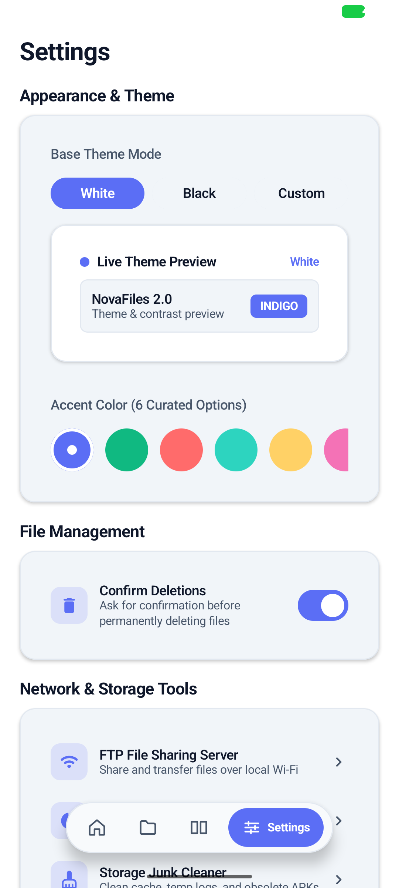

# NovaFiles

> **Modern, High-Performance File Manager, Media Browser & Storage Suite for Android**  
> Built with Kotlin, Jetpack Compose, Material 3, Clean Architecture, and AndroidX Media3.

---

## About NovaFiles

NovaFiles is a modern, power-user Android file manager designed for fluid navigation, comprehensive local media management, and intelligent storage exploration. Engineered completely from scratch using Modern Android Development (MAD) practices and a modular Clean Architecture, NovaFiles delivers a responsive, desktop-grade browsing experience directly on your mobile device.

Key design tenets:
- **Fast & Responsive**: Single-source-of-truth reactive UI powered by Kotlin Coroutines, StateFlow, and Jetpack Compose.
- **Uncompromised Power**: Multi-tabbed browsing, transactional batch file operations, cross-tab transfers, and Wi-Fi FTP file sharing.
- **Privacy & Safety**: Zero tracking, local-only processing, safe copy-then-delete transfers, and optional PIN application lock.
- **Modern Aesthetics**: Tri-mode base theming (White Light, AMOLED Pure Black, and Custom Palette Engine) with 6 curated accent colors.

---

## Features

### 📁 File Management
- **Unified Vertical Listing**: Folders and files displayed together in one vertical scrollable hierarchy, with folders prioritized at the top.
- **Flexible Layouts**: List View as default for detailed file metadata and Grid View for visual thumbnail exploration.
- **Context Actions (BUG-004)**: Tapping the three-dot button opens the file context menu (Open, Open with, Cut, Copy, Paste into, Rename, Delete, Share, Properties & Checksum, Add to Favorites, Compress, Extract) without accidentally triggering multi-selection.
- **Multi-Selection & Batch Dock**: Long-press any item to activate selection mode with bulk operations (Copy, Move, Delete, Share, Compress).
- **Clipboard Management**: Floating persistent dock displaying queued files with item counts, quick Paste, and Clear actions.
- **Fast Breadcrumb Navigation**: Tap any path segment in the breadcrumb bar to jump directly to parent directories.
- **In-Browser Search & Filtering**: Instant search across filenames and real-time category filtering.

### 📑 Multi-Pane Manager
- **Full-Screen Tabbed Browsing**: Multi-tab workspace replacing clumsy split-screen views.
- **Independent Tab State**: Each tab maintains its own directory history, scroll position, and selection state.
- **Tab Controls**: Quickly add new tabs (`+`), close inactive tabs, and tap or swipe between open locations.
- **Cross-Tab File Transfers**: Select items in one tab, cut or copy, switch tabs, and paste directly into another destination.

### 🖼️ Local Media Gallery
- **All Images View**: Chronological photo grid organized with date headers (Today, Yesterday, Months).
- **Folder Navigation**: Browse image folders with thumbnail previews and item counts.
- **Custom Albums**: Create, rename, and manage custom photo collections persisted locally.
- **Smart Hidden Folder Detection**: Excludes system caches (`.thumbnails`, `.cache`) while providing an optional toggle to show hidden media.
- **EXIF Metadata Sheet**: Inspect camera model, lens, aperture, shutter speed, ISO, focal length, and GPS coordinates.

### 🎬 Video Library & Player
- **Three-Section Library**: All Videos, Folders, and custom persistent Playlists.
- **Rich Video Badges**: Automatic duration tags and resolution badges (4K UHD, 1080p FHD, 720p HD, SD).
- **ExoPlayer Media3 Integration**: Hardware-accelerated playback with gesture brightness (left edge), volume (right edge), and continuous timeline scrubbing.
- **Playback Controls**: Variable speed playback (0.5x to 2.0x), audio and subtitle track selection, orientation lock, and technical stream metadata inspection.

### 🎵 Audio & Music Studio
- **Media3 Background Audio**: Persistent foreground playback notification with dynamic album artwork and lock-screen controls.
- **Home-Screen Widgets**: Interactive Glance widgets providing instant playback controls from your launcher.
- **Library Organization**: Browse tracks, albums, artists, and audio folders with live playlist queue support.

### 📊 Storage Analyzer & Cleaner
- **Storage Overview**: Visual capacity breakdown featuring an animated circular usage gauge and multi-segment category allocation bar.
- **Full-Screen Category Browser**: Drill into Audio, Videos, Documents, Images, and APKs in a dedicated browser view with full sorting and batch operations.
- **Junk Cleaner**: Scans for application cache remnants, temporary logs, obsolete APK installers, empty folders, and SHA-256 verified duplicate files.

### 🛠️ Utilities & System Tools
- **Wi-Fi FTP Server**: Embedded RFC 959 FTP server with passive mode support, sandboxed path validation, and notification controls.
- **Built-in Text & Code Editor**: Monospace code and text editor supporting `.txt`, `.md`, `.json`, `.xml`, `.log`, `.gradle`, and source files.
- **Tri-Mode Theming**:
  - `White`: Clean light canvas with high-contrast text.
  - `Black`: True AMOLED `#000000` base for maximum OLED battery savings.
  - `Custom`: Interactive color engine with palette swatches, HEX color inputs, and automatic text luminance contrast adjustment.
- **App Lock**: Optional PIN-based security gate protecting application launch.

---

## Screenshots

| Home Dashboard | File Manager | Context Menu |
|:---:|:---:|:---:|
|  |  |  |

| Multi-Pane Manager | Settings (AMOLED) | Settings (White) |
|:---:|:---:|:---:|
|  |  |  |

---

## Installation

### Download
Download the latest signed release APK from the [GitHub Releases](https://github.com/xan45/NovaFiles-2.0/releases) page:
- **File**: `NovaFiles-1.0.0-alpha1.apk`

### Sideloading Instructions
1. Download `NovaFiles-1.0.0-alpha1.apk` to your Android device.
2. Open your device's browser downloads or notifications and tap the downloaded file.
3. If prompted by Android, enable **Install unknown apps** for your browser or file manager.
4. Tap **Install** and launch NovaFiles from your app drawer.

### Permissions
NovaFiles requests only permissions strictly necessary for its functionality:
- `MANAGE_EXTERNAL_STORAGE` (`All files access`): Required on Android 11+ to browse, manage, copy, move, and edit files across your device storage.
- `POST_NOTIFICATIONS`: Required on Android 13+ to display background audio playback controls and FTP server status.
- `FOREGROUND_SERVICE`: Required to maintain uninterrupted background music playback, FTP transfers, and lengthy file copy operations.

---

## Compatibility

- **Application ID**: `com.xan.novafiles`
- **Minimum Android Version**: Android 8.0 Oreo (API Level 26)
- **Target Android Version**: Android 15 (API Level 35)
- **Compile SDK**: Android API 36
- **Architecture**: Kotlin 2.0, Jetpack Compose BOM 2024.10, Coroutines & StateFlow, AndroidX Media3 1.5.0

---

## Alpha Disclaimer

> ⚠️ **IMPORTANT NOTICE**: NovaFiles Alpha 1.0 (`1.0.0-alpha1`) is an early public testing release.
> - While core file operations are guarded by transactional verification, unexpected bugs or edge-case behavior may occur.
> - **Always back up important data** before performing destructive file operations (e.g. bulk deletions, moves across storage volumes).
> - We actively welcome early feedback, bug reports, and suggestions to help stabilize upcoming releases.

---

## Feedback & Bug Reporting

If you encounter issues or have suggestions:
1. Check existing [GitHub Issues](https://github.com/xan45/NovaFiles-2.0/issues) to see if the issue is already reported.
2. Open a new issue using our **Bug Report** or **Feature Request** templates.
3. Provide your device model, Android OS version, and detailed reproduction steps.

---

## Roadmap

### Current (Alpha 1.0 — Implemented)
- [x] Unified file manager with context menus and batch operations
- [x] Full-screen tabbed Multi-Pane manager with cross-tab transfers
- [x] Full-screen Storage Analyzer category browser
- [x] Comprehensive media gallery with albums and EXIF inspection
- [x] Video library with playlists and gesture player
- [x] Media3 music studio and home-screen Glance widgets
- [x] Wi-Fi FTP server with passive transfers
- [x] Tri-mode theming (White, AMOLED Black, Custom Palette Engine)
- [x] Storage junk cleaner with SHA-256 duplicate detection
- [x] Application package migration to `com.xan.novafiles`

### In Progress (Alpha 1.x)
- [ ] Drag-and-drop file movement between Multi-Pane tabs on large screen and foldable devices
- [ ] Advanced file search with regex and date/size query filters
- [ ] Enhanced ZIP archive extraction with password decryption

### Planned (Beta & v1.0 Stable)
- [ ] Cloud storage and network shares (SMB v2/v3, WebDAV, SFTP)
- [ ] User-customizable typography scaling and font family selection
- [ ] Split-screen dual pane mode for tablets and desktop environments (Samsung DeX)

---

## License

NovaFiles is licensed under the [Apache License, Version 2.0](LICENSE).
